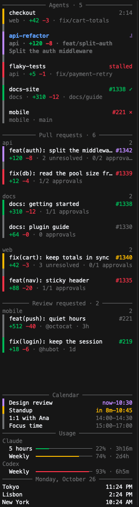

# tmux-aside

A sidebar for tmux, shown in every window, built from pluggable sections. It is made for working with several AI coding agents at once: one glance tells you which agent is working, which one is waiting for you and how your pull requests are doing, without leaving the terminal.

<p align="center"></p>

Color is used only as a state signal, with the same meaning in every section (diff stats such as `+120 -8` are always green and red):

| Color | Meaning | Agents | Pull requests | Usage |
|---|---|---|---|---|
| accent | in progress | working | checks running | |
| warning | needs you | waiting | changes requested | 70% or more |
| danger | broken | stalled | checks failing, conflicts | 90% or more |
| success | done, ready | finished | approved and green | below 70% |
| muted | idle | idle | waiting for review | |

To see it with fake data, without touching your tmux, run `examples/demo/run.sh` and attach with the command it prints. It starts a separate tmux server whose sections cover every state.

## How it works

- `tmux-aside on` adds a sidebar pane to every window and keeps it there through tmux hooks, also for windows created later.
- A daemon owns the content and the selection, so every sidebar shows the same thing and moving in one moves them all. It stops on its own a few seconds after the last sidebar closes.
- Each section is filled by a **plugin**: a separate program that prints JSON lines. The bundled plugins are listed below; [writing your own](docs/plugins.md) takes a few lines in any language.

## Requirements

- tmux 3.0 or newer (developed against tmux 3.6).
- Rust 1.88 or newer, to build it.
- Per plugin:
  - `github`: the [GitHub CLI](https://cli.github.com), logged in (`gh auth login`).
  - `agents`: [Claude Code](https://code.claude.com) for hook-reported status; any other agent CLI can be detected by its command.
  - `usage`: Claude Code with a `statusLine` command, and/or the `codex` CLI.
  - `calendar`: macOS. It reads the Calendar app, so it shows every account Calendar syncs (iCloud, Google, Exchange).

## Install

```sh
cargo install --locked --git https://github.com/eseceve/tmux-aside \
  tmux-aside tmux-aside-agents tmux-aside-github tmux-aside-usage tmux-aside-clock tmux-aside-calendar
```

Install only the plugins you want; `tmux-aside` finds a plugin named `NAME` as `tmux-aside-NAME` next to its own binary or in `PATH`.

## Quick start

1. Copy the [example config](examples/config.yaml) to `~/.config/tmux-aside/config.yaml` (or `$XDG_CONFIG_HOME/tmux-aside/config.yaml`) and edit it.
2. Bind the keys and let your AI agents report their status:

   ```sh
   tmux-aside setup
   ```

   For each action it lists a few keys, marked free or with what they run today in your tmux, with the first free one selected; `Other key...` takes a key as the list shows it (`prefix + r`) or as written after `bind-key` (`-n M-t` binds Alt+t without the prefix). Then it asks which AI hooks to install. Nothing changes until every question is answered.

   | Action | Keys offered |
   |---|---|
   | Toggle the sidebar | `prefix + B`, `S`, `e` |
   | Jump to the agent waiting (or done) the longest | `prefix + W`, `N`, `G` |
   | Reload the config | `prefix + R`, `O`, `Q` |

   The bindings go to a marked block in your tmux config, which a later run replaces, and take effect right away when run inside tmux. For Claude Code it runs `tmux-aside-agents setup claude` (status hooks) and `tmux-aside-usage setup claude` (wraps your `statusLine` to record plan usage), which keep a `settings.json.bak` copy and apply to sessions started afterwards. For Codex it runs `tmux-aside-agents setup codex`, which merges the status hooks into `~/.codex/hooks.json` (or `$CODEX_HOME`); Codex skips new hooks until you trust them with `/hooks`. For Antigravity it runs `tmux-aside-agents setup agy`, which adds them to `~/.gemini/config/hooks.json`; agy reports working and done, but no hook tells when it waits for you. Pass `--yes` to take the first key of each action and every hook, or give them as flags (`--toggle`, `--next`, `--reload`, `--hooks claude,codex,agy`, `--no-hooks`; `-` leaves an action unbound).
3. Turn the sidebar on with your toggle key, or `tmux-aside on`.

## Commands

| Command | |
|---|---|
| `tmux-aside on [--width N\|N%]` | Show the sidebar in every window. The default width is 10% of the window, between 25 and 50 columns. |
| `tmux-aside off` | Remove it from every window. |
| `tmux-aside toggle` | On if off, off if on. |
| `tmux-aside reload` | Reread the config and restart the plugins. Sections whose config did not change keep their content. |
| `tmux-aside setup` | Bind keys in your tmux config (`~/.tmux.conf`, or the XDG one when that is the one you have; `--config` to choose) and install AI hooks, asking for each. |

## Using the sidebar

| Key | |
|---|---|
| `j` `k`, arrows, mouse wheel | Move the selection |
| `h` `l`, space | Fold and unfold a section or group |
| `enter`, click | Run the row's main action, such as jumping to an agent or opening a pull request |
| `o` | Run the main action even when `enter: select` is set |
| `?` | Show the keys and the actions of the selected row |
| any other key | Run the selected row's action bound to that key, if any (e.g. `c` copies a pull request's URL) |

Folds are remembered across restarts. When the sections do not fit, the top ones scroll to keep the selection visible.

## Configuration

```yaml
theme:                 # colors: names (green, darkgray) or #rrggbb
  accent: "#be95ff"
  warning: "#f1c21b"
  success: green
  danger: red
  muted: "#7b7c7e"
  selection: "#393939" # background of the selected line; reversed text when unset
  current: "#78a9ff"   # text of the rows that belong to the window you are in
auto_reload: false     # reload when this file changes, without tmux-aside reload
enter: focus           # focus: Enter jumps to the row; select: Enter shows the row's window and keeps the focus in the sidebar
language: es           # en or es; your locale's ($LC_ALL, $LC_MESSAGES, $LANG) when unset, else English
sections:
  - plugin: agents     # plugin name, or a path to an executable
    args: ["--group", "none"]
```

Each section accepts:

| Key | Default | |
|---|---|---|
| `plugin` | | `NAME` runs `tmux-aside-NAME`; a path runs that file. |
| `args` | `[]` | Arguments passed to the plugin. |
| `mode` | `interval` | `interval` runs the plugin every `interval`; `stream` keeps it running and reads every snapshot it prints. |
| `interval` | `30s` | How often an interval plugin runs (`ms`, `s` or `m`). |
| `timeout` | `10s` | How long a run may take. For stream plugins it only bounds the wait for the first line. |
| `title` | the plugin's | Section title, shown as written. `${today}` expands to the date in the sidebar's language ("Monday, October 26", "Lunes 26 de Octubre"); `${today:en}` and `${today:es}` pick the language. |
| `header` | `true` | Draw the title line. |
| `counts` | `true` | Show how many rows the section and each group have. |
| `collapsed` | `false` | Start folded, unless you unfolded it before. |
| `density` | `compact` | `comfortable` leaves a line between rows. |
| `group_gap` | `false` | Leave a blank line between groups. |
| `max_height` | | Show at most this many rows and scroll the rest. |
| `pin` | `top` | `bottom` stacks the section at the bottom of the sidebar. |

Plugin logs go to `$XDG_STATE_HOME/tmux-aside/` (`~/.local/state/tmux-aside/` by default).

## Bundled plugins

Run any plugin with `--help` for every option.

### agents

Lists AI coding agents running in tmux panes. Claude Code, Codex and Antigravity report their status through hooks (`tmux-aside-agents setup claude`, `setup codex`, `setup agy`); panes running `claude`, `codex` or `agy` (Antigravity) are listed even before a hook reports them, and other agents can be found by their command with `--detect`. Each row names the agent (`CC`, `Codex`, `Agy`, or the command of a detected one), followed by its pane title (`CC: Fix the login flow`). Runs best with `mode: stream`.

- `--group project|none`: a group per project, or one list ordered by status across projects.
- `--sort priority|alphabetical|window`: priority puts agents waiting for you first; window follows the order of the tmux windows, so `tmux move-window` reorders the list.
- `--diff`: lines the agent's branch adds and removes (`+12 -3`), committed or not.
- `--stall-after 60s`: mark a working agent whose pane stopped changing (for example, after you interrupt it).
- `--detect aider`: also list panes running `aider` as agents, working while their pane changes.
- `--notify waiting --notify done --notify-via tmux --notify-via desktop`: notify when an agent needs you, unless you are looking at it.
- `tmux-aside-agents next [--status waiting,done]`: switch to the agent waiting the longest, or to the one done the longest when none waits; call it again to cycle. `--status` lists statuses in order of preference.
- `tmux-aside-agents list [--json]`: print each agent's pane, status, project, window and title, or their full state as JSON, for scripts and for an agent that coordinates others.
- Keys on a row: `enter` jumps to the agent, `p` opens its pull request.

### github

Lists the pull requests matching a [GitHub search](https://docs.github.com/en/search-github/searching-on-github/searching-issues-and-pull-requests), grouped by repository and colored by their combined state.

- `--query "is:pr is:open review-requested:@me archived:false"`: add `repo:owner/name` qualifiers to watch only some repositories; `OR` and parentheses group qualifiers.
- `--state-color number --state-color bar`: which parts take the state color.
- `--merge-info`: unresolved review threads and approvals.
- `--byline`: author and age.
- `--diff`: lines the pull request adds and removes (`+120 -8`).
- Keys on a row: `enter` opens the pull request, `c` copies its URL.

### usage

Shows how much of the Claude and Codex plan limits you have used, with the time left until each resets. Claude's limits are recorded by wrapping Claude Code's statusline (`tmux-aside-usage setup claude`); Codex's are read from the `codex` CLI.

- `--only-running`: hide a tool when none of its agents is running.

### clock

The time in several zones: `args: ["America/Santiago=Santiago", "Europe/Madrid=Madrid"]`. The clock of your system's zone is highlighted. Pair it with `title: ${today}` to show the date.

- `--sort alphabetical|earliest|latest|given`: by label (the default), the zone where it is earliest or latest first, or in the order given.

### calendar (macOS)

Upcoming events from the macOS Calendar. An event in progress shows `now–10:15`, one starting soon `in 8m–10:15`, and Enter joins its video call (Meet, Zoom, Teams, Webex or Whereby link). The first run asks for calendar access, granted to your terminal app.

- `--days 1 --limit 8 --soon 15m --calendar Work --all-day --declined`
- `--no-emoji`: remove emoji from titles. Terminals and tmux disagree on the width of some emoji (such as ✍ or 🛡), which misaligns the times.

## Contributing

See [CONTRIBUTING.md](CONTRIBUTING.md). To add a section, write a plugin: see [docs/plugins.md](docs/plugins.md).

## License

Licensed under either of [Apache License, Version 2.0](LICENSE-APACHE) or [MIT license](LICENSE-MIT) at your option.

Unless you explicitly state otherwise, any contribution intentionally submitted for inclusion in this project by you, as defined in the Apache-2.0 license, shall be dual licensed as above, without any additional terms or conditions.
