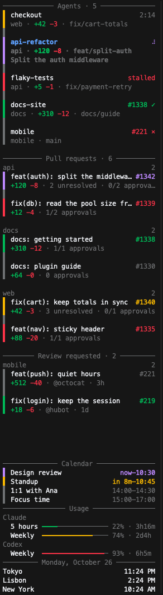

# tmux-aside

A sidebar for tmux, shown in every window, built from pluggable sections. It is made for working with several AI coding agents at once: one glance tells you which agent is working, which one is waiting for you and how your pull requests are doing, without leaving the terminal.

<p align="center"></p>

Color is used only as a state signal, with the same meaning in every section (diff stats such as `+120 -8` are always green and red):

| Color | Meaning | Agents | Pull requests | Usage |
|---|---|---|---|---|
| accent | in progress | working | checks running | |
| warning | needs you | waiting | changes requested | 70% or more |
| danger | broken | stalled | checks failing, conflicts | 90% or more |
| success | done, ready | finished | approved and green | below 70% |
| muted | idle | idle | waiting for review | |

To see it with fake data, without touching your tmux, run `examples/demo/run.sh` and attach with the command it prints. It starts a separate tmux server whose sections cover every state.

## How it works

- `tmux-aside on` adds a sidebar pane to every window and keeps it there through tmux hooks, also for windows created later.
- A daemon owns the content and the selection, so every sidebar shows the same thing and moving in one moves them all. It stops on its own a few seconds after the last sidebar closes.
- Each section is filled by a **plugin**: a separate program that prints JSON lines. The bundled plugins are listed below; [writing your own](docs/plugins.md) takes a few lines in any language.

## Requirements

- tmux 3.0 or newer (developed against tmux 3.6).
- Rust 1.88 or newer, to build it.
- Per plugin:
  - `github`: the [GitHub CLI](https://cli.github.com), logged in (`gh auth login`).
  - `agents`: [Claude Code](https://code.claude.com) for hook-reported status; any other agent CLI can be detected by its command.
  - `usage`: Claude Code with a `statusLine` command, and/or the `codex` CLI.
  - `calendar`: macOS. It reads the Calendar app, so it shows every account Calendar syncs (iCloud, Google, Exchange).

## Install

```sh
cargo install --locked --git https://github.com/eseceve/tmux-aside \
  tmux-aside tmux-aside-agents tmux-aside-github tmux-aside-watcher tmux-aside-usage tmux-aside-clock tmux-aside-calendar
```

Install only the plugins you want; `tmux-aside` finds a plugin named `NAME` as `tmux-aside-NAME` next to its own binary or in `PATH`.

## Quick start

1. Copy the [example config](examples/config.yaml) to `~/.config/tmux-aside/config.yaml` (or `$XDG_CONFIG_HOME/tmux-aside/config.yaml`) and edit it. If your team has a [Pack](#packs), skip this: `tmux-aside setup --pack` writes a config whose sidebar comes from the Pack.
2. Bind the keys and let your AI agents report their status:

   ```sh
   tmux-aside setup
   ```

   For each action it lists a few keys, marked free or with what they run today in your tmux, with the first free one selected; `Other key...` takes a key as the list shows it (`prefix + r`) or as written after `bind-key` (`-n M-t` binds Alt+t without the prefix). Then it asks which AI hooks to install. Nothing changes until every question is answered.

   | Action | Keys offered |
   |---|---|
   | Toggle the sidebar | `prefix + B`, `S`, `e` |
   | Focus the sidebar | `prefix + Tab`, `A`, `F` |
   | Jump to the agent waiting (or done) the longest | `prefix + W`, `N`, `G` |
   | Reload the config | `prefix + R`, `O`, `Q` |

   The bindings go to a marked block in your tmux config, which a later run replaces, and take effect right away when run inside tmux. For Claude Code it runs `tmux-aside-agents setup claude` (status hooks) and `tmux-aside-usage setup claude` (wraps your `statusLine` to record plan usage), which keep a `settings.json.bak` copy and apply to sessions started afterwards. For Codex it runs `tmux-aside-agents setup codex`, which merges the status hooks into `~/.codex/hooks.json` (or `$CODEX_HOME`); Codex skips new hooks until you trust them with `/hooks`. For Antigravity it runs `tmux-aside-agents setup agy`, which adds them to `~/.gemini/config/hooks.json`; agy reports working and done, but no hook tells when it waits for you. Pass `--yes` to take the first key of each action and every hook, or give them as flags (`--toggle`, `--focus`, `--next`, `--reload`, `--hooks claude,codex,agy`, `--no-hooks`; `-` leaves an action unbound).
3. Turn the sidebar on with your toggle key, or `tmux-aside on`.

## Commands

| Command | |
|---|---|
| `tmux-aside on [--width N\|N%]` | Show the sidebar in every window. The default width is 10% of the window, between 25 and 50 columns. |
| `tmux-aside off` | Remove it from every window. |
| `tmux-aside toggle` | On if off, off if on. |
| `tmux-aside focus` | Move the focus to the sidebar of the current window. Does nothing while the sidebar is off. |
| `tmux-aside reload` | Reread the config and restart the plugins. Sections whose config did not change keep their content. After reinstalling tmux-aside it restarts the sidebar on the new version instead. |
| `tmux-aside setup` | Bind keys in your tmux config (`~/.tmux.conf`, or the XDG one when that is the one you have; `--config` to choose), install AI hooks, the [skills](#skills) for each chosen AI (`--skills`, `--no-skills`) and optionally a [Pack](#packs) (`--pack PATH_OR_URL`), asking for each. |
| `tmux-aside uninstall [--delete-pack]` | Undo what setup added: the key bindings block, the AI hooks, the skills and the `pack` key, leaving everything else as it was. It asks before deleting a Pack it cloned (`--delete-pack` deletes it without asking); a Pack given by path is never deleted. |
| `tmux-aside launch REPO --template NAME --task TEXT --branch BRANCH [--base REF] [--group NAME]` | Start an AI agent on a task in its own branch, worktree and background window. See [Launching agents](#launching-agents). |
| `tmux-aside launch REPO --template NAME --pr URL [--task TEXT]` | Start an AI agent on an existing pull request, in a worktree of its branch. |
| `tmux-aside qa URL...` | Launch one QA agent, with a fresh context and the `qa` template, for pull requests that launches follow. |
| `tmux-aside deployed URL... [--task TEXT]...` | Run the [`on_deployed` action](#watcher) for deployed pull requests, in the current directory. The watcher runs it by itself. |
| `tmux-aside fix URL` | Launch an agent that fixes what QA found in a pull request, on a new branch in its repository and Group. |
| `tmux-aside follow URL` | Run from an agent's pane: make that agent the one the [watcher](#watcher) follows and nudges for the pull request. |
| `tmux-aside resurrect [--dry-run]` | Reopen the agent of every launch whose window is gone, such as after tmux or the computer restarted, resuming its latest conversation in its worktree. `--dry-run` only lists them. |
| `tmux-aside status [--json]` | List every launch with its repository, branch, worktree, window, agent, template, task, pull request and the stage the watcher last saw it in, with what it is missing (`QA · waiting for QA`). |

## Launching agents

`tmux-aside launch ~/src/app --template implement --task "https://github.com/org/app/issues/7" --branch feat/dark-theme` creates the branch from `--base` (the remote's default branch, `origin/HEAD`, unless given) in a worktree next to the clone (`~/src/app__worktrees/feat-dark-theme`), opens a window in the background in your current tmux session (or in a `tmux-aside` session outside tmux) and starts the agent there with the template's prompt. When the agent exits, the window keeps a shell.

A template is a Markdown file whose `${task}` is replaced by the task reference, which can be any text: a URL, an issue, a sentence. Its front matter says whether the agent opens a pull request, and may choose the AI:

```markdown
---
pull_request: true
ai: codex          # claude, codex or agy (Antigravity); the config's `ai`, or claude, when unset
---
Implement ${task} and open a pull request.
```

Agents are Claude Code by default; set `ai: codex` or `ai: agy` at the top of the config to change it, and a template's `ai` wins over it. Only AIs with tmux-aside status hooks are supported, because the watcher nudges an agent only when its hooks say it is done.

tmux-aside ships an `implement` template, an `adopt` one for `--pr`, a `qa` one for `tmux-aside qa` and a `fix` one for `tmux-aside fix`. Your own go in `$XDG_CONFIG_HOME/tmux-aside/templates/NAME.md` (`~/.config/tmux-aside/templates/` by default) and replace a bundled one with the same name.

To take over a pull request that was opened by hand, or whose agent was lost, run `tmux-aside launch ~/src/app --template adopt --pr https://github.com/org/app/pull/12`: it checks out the pull request's branch in a new worktree (reusing the local branch when there is one) and the task reference is the pull request's URL. The pull request must be open and belong to the clone's `origin` on GitHub; pull requests from forks are not supported. When an agent is already working on a pull request, let it register itself instead: `tmux-aside follow https://github.com/org/app/pull/12`, run from its pane (an agent can run it itself), records that agent with the worktree it runs in, and creates nothing. It needs the agent's tmux-aside hooks, so that its status is known.

Add `--group NAME` to put launches that belong together in a Group, such as the pull requests of one task across repositories, or those that must be tested together: the watcher shows them together and runs their QA once, for all of them.

### Skills

`tmux-aside setup` asks, for each AI you chose, whether to install two skills, so that an agent can launch work from a conversation: `/tmux-aside-launch` turns a request such as "start agents on issues 12 and 14 in api, as one group" into `tmux-aside launch` commands, choosing the template, repositories and branches, and `/tmux-aside-qa` runs `tmux-aside qa` and `tmux-aside fix`. They hold no logic beyond understanding the request and calling the commands. They go to `$CLAUDE_CONFIG_DIR/skills` (`~/.claude/skills`) for Claude Code and `$CODEX_HOME/skills` (`~/.codex/skills`) for Codex; Antigravity gets none yet. Running setup again replaces them and leaves your own skills alone.

### Packs

A Pack bundles a team's Criteria, Templates and default sidebar, so that everyone launches and follows work the same way without tmux-aside knowing anything private. It is a folder (usually a private git repository) with a `pack.yaml`:

```yaml
criteria:                     # the stages whose Criterion it replaces; see docs/criteria.md
  ready_to_merge:
    command: bin/ready-to-merge   # relative to the Pack's folder
    args: ["--team", "web"]
  ready_to_deploy:
    args: ["--passed-label", "qa:ok", "--failed-label", "qa:ko"]
templates: templates          # its Templates folder (the default)
on_deployed:                  # what the watcher does once pull requests are deployed
  template: deployed
theme:                        # the team's colors
  accent: "#8EB0FF"
sections:                     # the team's default sidebar
  - plugin: agents
  - plugin: bin/status        # a relative path runs a plugin inside the Pack
```

Install it with `tmux-aside setup --pack PATH_OR_URL`, or answer the setup's question. A path is used in place, so you can develop a Pack without copying it. A git URL is cloned once, with your own git credentials, into `$XDG_DATA_HOME/tmux-aside/packs/` (`~/.local/share/tmux-aside/packs/` by default); running the command again pulls it fast-forward only, and nothing updates it on its own. Either way setup only writes `pack:` in the config. The manifest takes every key of the [config](#configuration) but `pack`, and the config wins over it: each key comes from the config when it sets it, even to `false`, else from the Pack, else from the default. `sections`, `discover` and `on_deployed` come whole from the first that sets them, so to change the Pack's sidebar you copy its `sections` into your config and edit them there; `theme` and `criteria` merge per color and per stage. Templates resolve by name from your own folder, then the Pack's, then the bundled ones. A relative `command` or `plugin` path in the manifest is relative to the Pack's folder. tmux-aside reads only the manifest and runs only what it declares; an invalid manifest is reported and the defaults are used. A manifest with a key your tmux-aside does not know yet is invalid, so update tmux-aside before pulling a Pack that uses a new key. `auto_reload` watches only the config file: run `tmux-aside reload` after the Pack changes.

Launches are recorded in `$XDG_STATE_HOME/tmux-aside/launches/`, so `tmux-aside status` still lists them after tmux or the computer restarts. Run `tmux-aside resurrect` then to reopen their agents: each one resumes its latest conversation in its worktree (`claude --continue`, `codex resume --last`, `agy --continue`) in a new window of its session.

The [watcher](#watcher) section follows the pull request of every launch whose template opens one.

## Using the sidebar

| Key | |
|---|---|
| `j` `k`, arrows, mouse wheel | Move the selection |
| `h` `l`, space | Fold and unfold a section or group |
| `enter`, click | Run the row's main action, such as jumping to an agent or opening a pull request |
| `o` | Run the main action even when `enter: select` is set |
| `?` | Show the keys and the actions of the selected row |
| any other key | Run the selected row's action bound to that key, if any (e.g. `c` copies a pull request's URL) |

Folds are remembered across restarts. When the sections do not fit, the top ones scroll to keep the selection visible.

## Configuration

A [Pack](#packs) can set any of these keys but `pack`; whatever your config sets wins over it.

```yaml
theme:                 # colors: names (green, darkgray) or #rrggbb
  accent: "#be95ff"
  warning: "#f1c21b"
  success: green
  danger: red
  muted: "#7b7c7e"
  selection: "#393939" # background of the selected line; reversed text when unset
  current: "#78a9ff"   # text of the rows that belong to the window you are in
auto_reload: false     # reload when this file changes, without tmux-aside reload
auto_qa: false         # the watcher launches a Group's QA by itself once it is ready
on_deployed:           # the watcher starts an AI once pull requests are deployed; nothing when unset
  template: deployed   # the template it starts with (the default)
  window: false        # true: an interactive agent in a background window; false: headless (the default)
ai: claude             # the AI launched agents start (claude, codex or agy), unless their template names one
pack: /home/me/team-pack  # a Pack's folder (~ is not expanded); written by tmux-aside setup --pack
enter: focus           # focus: Enter jumps to the row; select: Enter shows the row's window and keeps the focus in the sidebar
language: es           # en or es; your locale's ($LC_ALL, $LC_MESSAGES, $LANG) when unset, else English
sections:
  - plugin: agents     # plugin name, or a path to an executable
    args: ["--group", "none"]
```

Each section accepts:

| Key | Default | |
|---|---|---|
| `plugin` | | `NAME` runs `tmux-aside-NAME`; a path runs that file. |
| `args` | `[]` | Arguments passed to the plugin. |
| `mode` | `interval` | `interval` runs the plugin every `interval`; `stream` keeps it running and reads every snapshot it prints. |
| `interval` | `30s` | How often an interval plugin runs (`ms`, `s` or `m`). |
| `timeout` | `10s` | How long a run may take. For stream plugins it only bounds the wait for the first line. |
| `title` | the plugin's | Section title, shown as written. `${today}` expands to the date in the sidebar's language ("Monday, October 26", "Lunes 26 de Octubre"); `${today:en}` and `${today:es}` pick the language. |
| `header` | `true` | Draw the title line. |
| `counts` | `true` | Show how many rows the section and each group have. |
| `collapsed` | `false` | Start folded, unless you unfolded it before. |
| `density` | `compact` | `comfortable` leaves a line between rows. |
| `group_gap` | `false` | Leave a blank line between groups. |
| `max_height` | | Show at most this many rows and scroll the rest. |
| `pin` | `top` | `bottom` stacks the section at the bottom of the sidebar. |
| `hidden` | `false` | Run the plugin without showing the section, for a plugin that acts rather than shows, such as the [watcher](#watcher). |

Plugin logs go to `$XDG_STATE_HOME/tmux-aside/` (`~/.local/state/tmux-aside/` by default).

## Bundled plugins

Run any plugin with `--help` for every option.

### agents

Lists AI coding agents running in tmux panes. Claude Code, Codex and Antigravity report their status through hooks (`tmux-aside-agents setup claude`, `setup codex`, `setup agy`); panes running `claude`, `codex` or `agy` (Antigravity) are listed even before a hook reports them, and other agents can be found by their command with `--detect`. Each row names the agent (`CC`, `Codex`, `Agy`, or the command of a detected one), followed by its pane title (`CC: Fix the login flow`). Runs best with `mode: stream`.

- `--group project|none`: a group per project, or one list ordered by status across projects.
- `--sort priority|alphabetical|window`: priority puts agents waiting for you first; window follows the order of the tmux windows, so `tmux move-window` reorders the list.
- `--diff`: lines the agent's branch adds and removes (`+12 -3`), committed or not.
- `--stall-after 60s`: mark a working agent whose pane stopped changing (for example, after you interrupt it).
- `--detect aider`: also list panes running `aider` as agents, working while their pane changes.
- `--notify waiting --notify done --notify-via tmux --notify-via desktop`: notify when an agent needs you, unless you are looking at it.
- `tmux-aside-agents next [--status waiting,done]`: switch to the agent waiting the longest, or to the one done the longest when none waits; call it again to cycle. `--status` lists statuses in order of preference.
- `tmux-aside-agents list [--json]`: print each agent's pane, status, project, window and title, or their full state as JSON, for scripts and for an agent that coordinates others.
- Keys on a row: `enter` jumps to the agent, `p` opens its pull request.

### github

Lists the pull requests matching a [GitHub search](https://docs.github.com/en/search-github/searching-on-github/searching-issues-and-pull-requests), grouped by repository and colored by their combined state.

- `--query "is:pr is:open review-requested:@me archived:false"`: add a `repo:owner/name` qualifier to watch only one repository. Qualifiers separated by spaces must all match, so join several repositories with `OR` inside parentheses: `(repo:owner/a OR repo:owner/b)`.
- `--state-color number --state-color bar`: which parts take the state color.
- `--merge-info`: checks still running (`◷ Jenkins, CodeRabbit`), unresolved review threads and approvals.
- `--byline`: author and age.
- `--diff`: lines the pull request adds and removes (`+120 -8`).
- `--labels merge:`: labels that start with the prefix (`merge:blocked · merge:depends-on`); repeat for several prefixes.
- `--reviewers`: everyone who reviewed or was asked to, alphabetical, with where they stand (`◆ bob · ✓ felicandalc · ◷ compara-ai-rollout`): ✓ approved, ◆ changes requested, ○ commented, ◷ asked to review (again, when they reviewed before).
- `--blocked-label merge:blocked`: pull requests with the label take the warning state (`⊘`), unless their checks fail, they conflict or changes were requested; repeat for several labels.
- Keys on a row: `enter` opens the pull request, `c` copies its URL.

### watcher

Follows the pull request of every [launch](#launching-agents) whose template opens one: the open pull request of its branch on GitHub, or the one it already followed once that is merged or closed (pull requests from forks are ignored), with one row per launch grouped by repository. Each row shows the stage of the Lifecycle and what it is missing: `Implementing · waiting for approval`, `Implementing · conflicts`, `Ready to merge · waiting to be merged`, `QA · waiting for QA`. By default:

- **Implementing → Ready to merge**: the pull request is approved, its checks pass and it merges cleanly. It goes back to Implementing when that stops being true.
- **QA**: once merged, the change waits to be verified in a pre-production environment. The pull requests of a Group are verified together, once every one reached QA; until then their rows say which ones QA waits for (`QA · waiting for #13`). Press `q` on a row of a ready Group, or run `tmux-aside qa URL...`, to launch one QA agent for all of them with the `qa` template; it records its verdict as the `qa:passed` or `qa:failed` label with a comment of the cases it tested, and closes its pane, and so its window, when every pull request passed. `qa:failed` turns the row red; press `f` on it, or run `tmux-aside fix URL`, to launch an agent with the `fix` template on a new branch (`fix/qa-12`), in the same Group, pointed at the QA report. QA then reruns for the pull request and its fix together, once the fix reaches QA.
- **Ready to deploy → Deployed**: with the `qa:passed` label the change is ready to go to production, and by default it counts as deployed right away, so its row leaves. A Deployed Criterion of your own, one that knows your deploy pipeline, keeps the row at Ready to deploy until the change is in production.

It can also follow pull requests nobody launched: list where to find them under `discover:` at the top of the config, either a GitHub search (up to 50 results) or a command that prints pull request URLs, one per line:

```yaml
discover:
  - search: "is:pr is:open author:@me archived:false (repo:org/app OR repo:org/api)"
  - command: /path/to/list-pending-pull-requests
    args: ["--some", "flag"]
```

Each one found that no launch follows yet is followed from then on, with no agent and no worktree of its own; `tmux-aside status` lists it. When an agent works on its branch, in a clone of its repository, the watcher links that agent to it so it gets the Nudges, and never removes that worktree. List only pull requests in flight: one that leaves after being deployed or closed is not followed again only because the source stops listing it.

A closed pull request leaves too. To have the watcher nudge agents, clean up and run QA without its section taking room in the sidebar, add `hidden: true` to it: it keeps running, and `tmux-aside status` still lists every launch. Set `auto_qa: true` at the top of the config to have the watcher launch a Group's QA by itself once the Group is ready, once per set of pull requests; `q` and `tmux-aside qa` can repeat it either way. Runs with `mode: stream`:

```yaml
- plugin: watcher
  mode: stream
```

To act once pull requests are in production, such as updating their tasks, set `on_deployed:` in the config or the Pack. In each fetch, the watcher runs `tmux-aside deployed` once for every pull request that reached Deployed since the last one, in the clone of the first. It starts the AI with the `deployed` template (`template:` names another), where `${task}` stands for their distinct Task references and `${urls}` for their URLs, each sorted and joined by spaces; a pull request nobody launched has its URL as Task reference. It runs once per pull request, even if it fails. By default the AI runs headless (`claude -p`, `codex exec`, `agy --print`) and its output goes to the watcher's log, so it can only use the tools it is already allowed to; `window: true` starts an interactive agent in a background window instead. With the default Deployed Criterion, a pull request is deployed as soon as it has the `qa:passed` label.

```markdown
<!-- ~/.config/tmux-aside/templates/deployed.md -->
Update the status of the tasks ${task}, whose pull requests ${urls} are in production.
```

When the pull request has conflicts, or unresolved review comments, the watcher types a Nudge into its agent asking it to resolve or answer them. It types only while the agent is idle (done, not working or waiting for you, with its status reported by the [agents](#agents) hooks) and you are not looking at its pane, and at most once per stage and head commit of the pull request, so a new push allows it again.

Once the pull request is merged or closed, the watcher removes the launch's worktree and closes the agent's pane, which closes its window unless you split it. The branch is kept; files git ignores, such as `.env` files and build outputs, are removed with the worktree. When uncommitted changes or commits that are on no remote branch would be lost, it removes nothing and the row warns in yellow (`QA · uncommitted changes kept in the worktree`) until you deal with them, and stays even once deployed or closed.

Each stage is decided by a Criterion, an executable you can replace per stage under `criteria:` in the config, for example to require a team's review or to wait for your deploy pipeline; see [Writing a Criterion](docs/criteria.md). To name the QA labels differently, pass them to the default Ready to deploy Criterion:

```yaml
criteria:
  ready_to_deploy:
    args: ["--passed-label", "qa:ok", "--failed-label", "qa:ko"]
```

- `--interval 30s`: how often pull requests are fetched, all of them in one GitHub query.
- `--tmux-aside PATH`: the `tmux-aside` command QA is launched with, when it is not next to the watcher or in `PATH`.
- Keys on a row: `enter` jumps to the agent, `p` opens the pull request, `q` launches QA for its Group once the Group is ready, `f` launches a fix once QA failed.

### usage

Shows how much of the Claude and Codex plan limits you have used, with the time left until each resets. Claude's limits are recorded by wrapping Claude Code's statusline (`tmux-aside-usage setup claude`); Codex's are read from the `codex` CLI.

- `--only-running`: hide a tool when none of its agents is running.

### clock

The time in several zones: `args: ["America/Santiago=Santiago", "Europe/Madrid=Madrid"]`. The clock of your system's zone is highlighted. Pair it with `title: ${today}` to show the date.

- `--sort alphabetical|earliest|latest|given`: by label (the default), the zone where it is earliest or latest first, or in the order given.

### calendar (macOS)

Upcoming events from the macOS Calendar. An event in progress shows `now–10:15`, one starting soon `in 8m–10:15`, and Enter joins its video call (Meet, Zoom, Teams, Webex or Whereby link). The first run asks for calendar access, granted to your terminal app.

- `--days 1 --limit 8 --soon 15m --calendar Work --all-day --declined`
- `--no-emoji`: remove emoji from titles. Terminals and tmux disagree on the width of some emoji (such as ✍ or 🛡), which misaligns the times.

## Contributing

See [CONTRIBUTING.md](CONTRIBUTING.md). To add a section, write a plugin: see [docs/plugins.md](docs/plugins.md).

## License

Licensed under either of [Apache License, Version 2.0](LICENSE-APACHE) or [MIT license](LICENSE-MIT) at your option.

Unless you explicitly state otherwise, any contribution intentionally submitted for inclusion in this project by you, as defined in the Apache-2.0 license, shall be dual licensed as above, without any additional terms or conditions.
